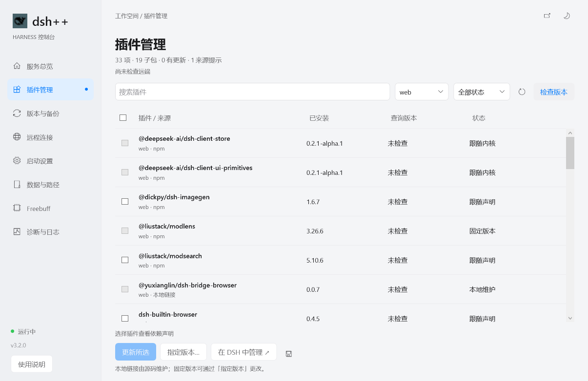

# dsh++

DeepSeek Harness 的 Windows 桌面控制台。3.2 补全后台插件检查、聚合子包发现、锁文件来源提示和安装目标核验，保留重启接续、维护记录、中断恢复与双主题界面。

## 使用

需要 Windows 10/11、.NET 8 Desktop Runtime、Node.js，以及已安装的 DSH。当前启动方式已在 DSH 0.2.1-rc.2 上验证。新配置默认仅本机访问、需要远程配对、不启用公网隧道；已有配置保留原来的连接偏好。

1. 完整解压 Windows x64 发布包，保留 EXE、compat-polyfill.js 和 scripts 目录。
2. 在「数据与路径」确认 DSH 安装目录与数据目录。
3. 在「远程连接」选择局域网、Tailscale 或自定义域名；仅本机使用时，在「启动设置」开启对应选项。
4. 从「服务总览」启动，等待“运行中”，再点「打开 DSH」。

旧版自更新器只替换 EXE 时，新版可从内嵌资源提供匹配的运行与更新脚本，缓存在状态目录的 runtime-assets 下，不依赖被覆盖或遗漏的外置脚本；完整发布包仍是推荐安装方式。

本机管理入口固定为 http://127.0.0.1:端口。远程模式额外在选中的具体网卡地址提供转发；转发保留 Host、Origin 和来源标记，远程客户端仍受 DSH 认证与远程插件配对检查控制。控制台不再生成 0.0.0.0 绑定。更改网卡、连接方式、域名后重启服务生效；修改端口或数据目录前先停止服务。

插件市场在原启动参数及环境下重启 DSH 时，新进程会向同一次启动的宿主登记；远程转发在等待期间返回 503，登记后继续工作，不会随旧进程退出而消失。未登记进程不会在 DSH 缺席时通过该转发对外提供服务。等待上限使用 StartupTimeoutSeconds，到期仍无替代进程则关闭转发。明确停止服务后，迟到的同次启动进程也不会重新拉起服务。清理环境变量或替换启动入口的第三方重启方式不在此接续范围内。

## 插件维护

「插件管理」列出每个 profile 的直接入口与聚合子插件、已安装版本、实际来源和更新策略。可以按 profile、可维护、有新版、固定版本、本地链接、官方依赖、来源异常和聚合子包筛选，并导出当前显示的 JSON 清单。聚合子包显示所属更新入口，不会在更新时意外提升为直接依赖。搜索与筛选只影响显示；“更新所选”处理所有勾选入口。

“打开时检查控制台、内核与 web 插件”会后台检查三个目标，不安装依赖、不联网修复或阻挡服务启动。手动检查覆盖当前 profile 的全部入口和已发现子包，不受搜索或“有新版”筛选隐藏；普通刷新保留安装信息没有变化的检查结果。失败显示失败与检查时间，不把网络故障当成“已是最新”。维护开始前会取消并等待插件检查结束。

npm 同时查询 latest 与声明内目标；声明范围外的新版本提示“声明限制”，需用“指定版本”明确改变范围。Git 浮动分支比较远端提交与锁定提交，固定 tag 列出更高版本 tag，注解 tag 使用剥离后的提交。只沿含 dsh.bundle 元数据的依赖展开聚合插件，不扫描所有普通 npm 工具依赖。

| 来源 / 声明 | 默认行为 |
| --- | --- |
| npm 版本范围 | 显示 latest，普通更新只安装声明内精确目标 |
| 未固定版本的 GitHub / Git | 查询远端 ref，安装精确提交后保留原分支声明 |
| 精确版本、Git tag、commit | 保留；用“指定版本”明确修改目标 |
| link: / file: / workspace: | 本地维护，不交给批量更新 |
| @deepseek-ai/* 伴随包 | 标记“跟随内核”，不参加普通插件更新 |
| 聚合子包 | 检查版本，由所属直接入口维护 |

一次更新按以下顺序执行：确认声明与停机影响 → 在原服务运行时解析精确版本 / 提交 → 取得维护锁并检查依赖未被其他程序改动 → 保存恢复点 → 停止原服务 → 仅安装所选入口的精确目标 → 核对实际版本 / Git 提交及来源 → 保留原声明 → 配置组合检查 → 按偏好重新启动并验证网页。解析失败或目标已经就位时不停止服务；命令退出 0 却没有达到目标仍视为失败。失败或取消后恢复原清单与锁文件，再安装原依赖；原服务之前运行时尝试恢复启动。恢复依赖需要本地缓存或网络，失败时保留恢复点并报告错误。

pnpm-lock.yaml 是版本与来源记录，不是长期占用文件的互斥锁。安装与恢复需要可复现的解析结果，主动更新则只刷新明确选择的目标。3.2 用 YamlDotNet 解析锁文件：远端声明对应本地 file: 归档 / link:、声明不一致、格式损坏都会提示来源问题；不删除整个锁文件或自动升级全部插件。安装精确目标后，只恢复该项的原声明，保留 pnpm 生成的版本、提交、完整性哈希和共享依赖图。跨包共享依赖仍可能随所选目标变化。

更新过程中可以取消，取消后的恢复阶段需等待完成。其他服务启停和依赖修改在维护期间不可并行执行。跨控制台进程的维护通过文件独占锁协调。

固定 GitHub tag 不会自动跳到新 tag。运行时更新器不会自动修复所有社区插件的 API 不兼容；组合检查只验证静态配置，原服务此前未运行时不会自行拉起服务做运行验证。

## 版本与备份

- DSH：查看 npm latest / alpha 通道，安装前解析精确版本，只备份安装目录与实际同步的 web profile。内核更新时同步 web profile 的官方伴随包，也可以单独点“同步官方依赖”；目标版本来自实际内核安装目录，其他 profile 与社区插件不参加这一步。
- dsh++：检查 GitHub Windows x64 发布包，验证必需文件后替换，旧程序保留在 app-updates 目录。
- 恢复点：保存 package.json、pnpm-lock.yaml / package-lock.json、cordis.patch.yml、pnpm-workspace.yaml 和 .npmrc；不复制会话或凭据数据目录。存在锁文件时按锁安装；没有锁文件时仅能按原声明重新解析，不能保证传递依赖的原版本。
- 手动备份：使用插件页选择的 profile；“全部 Profile”时默认为 web。目录里仍可能包含敏感配置，请妥善保管恢复点。
- 维护记录：保存在状态目录的 history 下，包含目标、阶段、结果、恢复点与包管理子进程信息。控制台异常退出后，未完成任务显示为“待恢复”，新的依赖修改暂停；启动 DSH 不受此限制，不自动联网修复。在“恢复中断任务”中明确确认后，会核对并结束该任务遗留的 Node 安装进程，再保存当前恢复点并恢复旧依赖。记录与恢复点只覆盖依赖及配置，不提供会话数据库迁移回滚。

## 诊断

「诊断与日志」检查安装版本、计划绑定、端口进程归属、npm / pnpm、缺失的客户端构建产物、核心伴随包版本差异和 profile 配置组合。日志支持复制、导出和暂停跟随，常见 token、API key、密码与 Authorization 值会脱敏；导出前仍应检查插件是否输出了未识别的敏感字段。

Freebuff 保留为独立 Docker 组件，由用户手动启停。启动 dsh++ 不会启动 Freebuff；连接信息默认隐藏。配置中的 FreebuffDir 与 FreebuffDocker 可以调整项目和 Docker Desktop 路径。

## 配置

默认状态目录是 %APPDATA%\dsh-control；可以用 DSHPP_STATE_DIR 指定独立状态目录。config.json 持久化主题、窗口位置、数据路径、启动与更新偏好。旧版 AutoUpdatePlugins 自动迁移为关闭，CheckUpdatesOnLaunch 只做版本检查。配置采用临时文件写入后替换，窗口尺寸尚未保存时的 NaN 值可以正常序列化。

| 设置 | 用途 |
| --- | --- |
| DshAppDir | 包含 node_modules/@deepseek-ai/dsh 的安装目录 |
| DshHome / AgentsHome | 传给服务的 DSH_HOME / DSH_AGENTS_HOME |
| Mode / AccessMode / BindHost | 本机或远程模式、连接方式、具体网卡；BindHost 为空时自动选择 |
| RestartAfterUpdate | 更新后恢复原先运行的服务，默认开启 |
| StartupTimeoutSeconds | 网页就绪及重启接续等待，默认 60 秒；设置页可调整 10–180 秒 |
| UpdateTimeoutMinutes | 每条包管理命令超时，默认 15 分钟；设置页可调整 1–60 分钟 |
| BrowserCompatibilityPatch | 是否应用已有的旧浏览器兼容补丁 |

## 开发与验证

~~~powershell
dotnet build dsh-plus-plus.csproj -c Release
dotnet publish dsh-plus-plus.csproj -c Release -r win-x64 -o publish
.\publish\dsh-plus-plus.exe --self-test
.\publish\dsh-plus-plus.exe --smoke
.\publish\dsh-plus-plus.exe --render-check "F:\temp\dshpp-ui"
.\publish\dsh-plus-plus.exe --service status
.\publish\dsh-plus-plus.exe --check-plugins web
node --test tests/runtime-host.test.mjs
~~~

self-test 使用临时目录检查目标解析、声明保留、旧产物假成功拒绝、失败 / 取消恢复、聚合发现、来源偏差、注解 tag 和维护互斥；另外用本机回环 registry 驱动真实 npm / pnpm，验证更新后的锁文件仍可 frozen offline 安装。不修改用户 profile，不需要外网 registry。Node 集成检查验证 HTTP / WebSocket 转发、来源标记、进程替换接续、停止与超时释放。render-check 输出 8 个页面在深浅主题、1220×820 / 960×700 窗口下的 32 张真实 WPF 渲染图与按钮裁切报告，另有 4 张宽 / 窄更新确认窗口图；不执行依赖更新或模型调用。

check-plugins 是只读版本诊断，默认检查 web；结果写入状态目录的 plugin-update-check.json。任一远端检查失败或 profile 不存在时退出码为 1，发现新版或来源提示本身不视为命令失败。

service 支持 start / stop / restart / status；结果写入状态目录的 service-result.txt。服务由独立 Node 宿主维持，关闭控制台可以保留后台服务；端口停止操作会先检查 DSH 进程归属。

主要文件：RuntimeLifecycle.cs 负责服务生命周期；PluginInventory.cs、PluginLock.cs 与 PluginUpdates.cs 负责聚合发现、来源读取和目标解析；PluginMaintenance.cs 与 MaintenanceHistory.cs 负责维护、记录和恢复；CommandRunner.cs 负责取消与超时；scripts/runtime-host.mjs 负责服务登记与远程转发；MainWindow.xaml(.cs) 与 UpdatePreviewWindow.xaml(.cs) 负责界面。

Windows 发布包与变更记录见 [GitHub Releases](https://github.com/Jensen-Yao/dsh-plus-plus/releases)。

MIT License.
