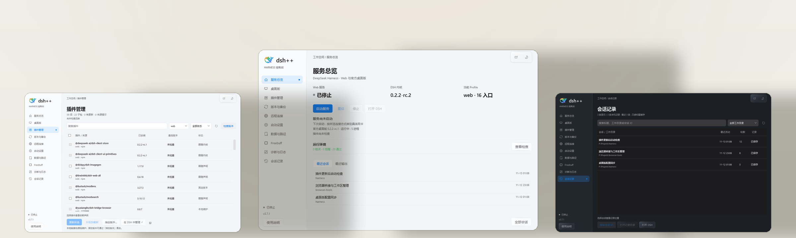
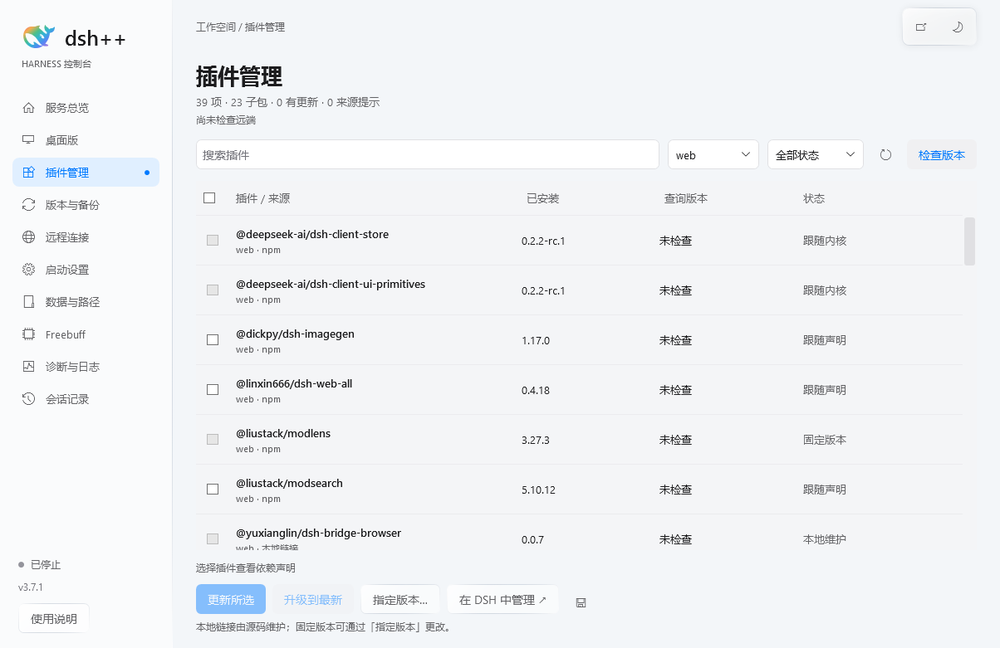
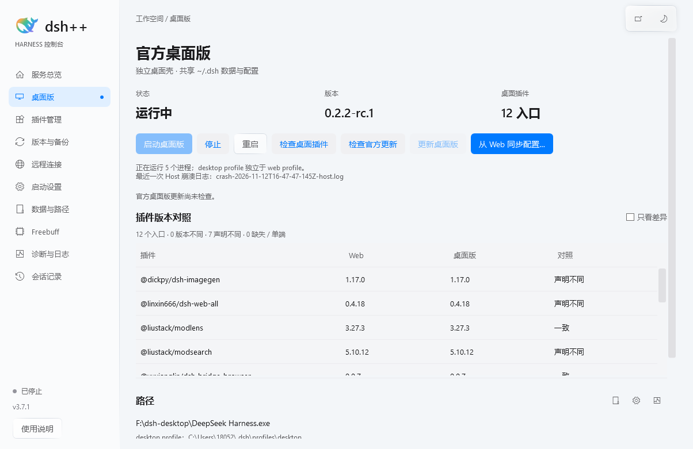
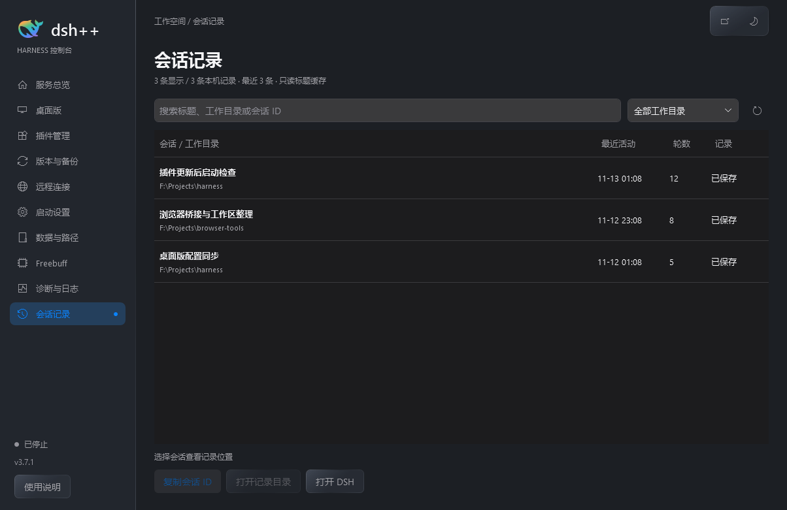

# dsh++

**给 DeepSeek Harness 配的 Windows 桌面遥控器**

不用记命令行——启动、更新、排查，都在一个窗口里。

[下载最新版](https://github.com/Jensen-Yao/dsh-plus-plus/releases/latest) · [快速开始](#三步开始) · [常见问题](#常见问题) · [项目主页](https://jensen-yao.github.io/dsh-plus-plus/)

---

## dsh++ 帮你做什么

DSH 本体是一套命令行工具：启动要敲参数、插件升级要看 npm、出问题要翻日志。dsh++ 把这些日常操作收进一个桌面窗口，并替你盯住那些容易出错的环节。

| | |
| --- | --- |
| 🚀 **启动与远程** | 一键启动 / 停止 / 重启 DSH Web；手机用同一 Wi-Fi、Tailscale 或自定义域名访问，地址大字展示、一键复制 |
| 🧩 **插件更新** | 看得懂的更新提示：为什么装不上、声明是什么、怎么解除；「升级到最新」可选固定版本或浮动声明，本地源码插件不会被静默替换 |
| 🛡️ **防不兼容** | 更新前核对插件的 DSH 内核要求，版本不够会先拦下来并告诉你先升内核——不再装完才发现打不开 |
| 🖥️ **官方桌面版** | 启停官方 Electron 桌面壳、同步 Web 配置、走官方通道更新；两端插件版本一页对照 |
| ⬆️ **内核升级** | 正式版 / RC / 预览版三个通道，升级前后自动备份，失败一键回滚 |
| 🩺 **健康诊断** | 本地只读体检：配置损坏、来源异常、中断的维护任务都能提前发现；overlay 配置坏了可以一键修复 |

## 三步开始

1. **解压** [win-x64.zip](https://github.com/Jensen-Yao/dsh-plus-plus/releases/latest)，保留 EXE、`compat-polyfill.js` 和 `scripts` 目录，放进一个固定位置；
2. **启动**：在「数据与路径」确认 DSH 安装目录后，从「服务总览」启动，等待"运行中"；
3. **打开 DSH**：点「打开 DSH」进入 localhost。想用手机？「远程连接」页选局域网 / Tailscale / 域名。

> 需要 Windows 10/11、[.NET 8 Desktop Runtime](https://dotnet.microsoft.com/download/dotnet/8.0)、Node.js 和已安装的 DSH。

## 常见问题

**更新插件时提示「有新版（声明 范围外）」或「固定 版本」，怎么办？**
这是 package.json 里的版本声明把新版挡住了，普通更新只装声明范围内的版本。选中插件点「升级到最新」，可以选择固定到新版，或改成 `^` 浮动声明（以后普通更新就能继续升级）。注意 0.x 包的 `^` 只跟随同一小版本。

**提示「需内核 ≥x.y.z」？**
插件要求更高的 DSH 内核。先到「版本与备份」页升级内核（正式版 / RC 版 / 预览版），再回来更新插件。

**官方桌面版打不开？**
多数情况是 `cordis.patch.yml` 被官方插件安装器写坏。打开「诊断与日志」→ 重新检查，会直接指出问题；点「修复 overlay patch」即可恢复（自动备份原文件）。

**Web 和桌面版能同时开吗？**
可以，但任务看板有单写锁，同时运行时后启动一端的看板会降级；核心聊天、会话和插件界面不受影响。

**会话记录会被修改吗？**
不会。「会话记录」页只读列出官方会话目录的标题与活动时间，不解压、不迁移、不改写任何官方数据。

---

## 进阶说明

<b>使用与网络</b>

新配置默认仅本机访问、需要远程配对、不启用公网隧道；已有配置保留原来的连接偏好。本机管理入口固定为 http://127.0.0.1:端口。远程模式在选中的具体网卡地址提供转发，不绑定 0.0.0.0；转发保留 Host、Origin 和来源标记，远程客户端仍受 DSH 认证与远程插件配对检查控制。更改网卡、连接方式、域名后重启服务生效；修改端口或数据目录前先停止服务。

插件市场在原启动参数及环境下重启 DSH 时，新进程会向同一次启动的宿主登记；远程转发在等待期间返回 503，登记后继续工作。等待上限使用 StartupTimeoutSeconds；明确停止服务后，迟到的同次启动进程不会重新拉起服务。

<b>插件维护语义</b>

「插件管理」列出每个 profile 的直接入口与聚合子插件、已安装版本、实际来源和更新策略，支持按 profile、可维护、有新版、固定版本、本地链接、官方依赖、来源异常和聚合子包筛选，可导出 JSON 清单。聚合子包显示所属更新入口，不会在更新时意外提升为直接依赖。

npm 同时查询 latest 与声明内目标，并读取目标版本的 DSH 内核要求（peerDependencies 的 @deepseek-ai/dsh，回退 dsh.engines.dsh）；不满足时状态、详情与确认框都会说明，安装前解析阶段硬性拦截（不停止服务、不修改依赖）。

| 来源 / 声明 | 默认行为 |
| --- | --- |
| npm 版本范围 | 显示 latest，普通更新只安装声明内精确目标 |
| 未固定版本的 GitHub / Git | 查询远端 ref，安装精确提交后保留原分支声明 |
| 精确版本、Git tag、commit | 批量更新保留；可用「升级到最新」切换新 tag / 版本（npm 可选固定或浮动声明） |
| link: / file: / workspace: | 批量更新保留本地来源；可用「升级到最新」切换远端发布版（先核对 repository 身份） |
| @deepseek-ai/* 伴随包 | 标记"跟随内核"，不参加普通插件更新 |
| 聚合子包 | 检查版本，由所属直接入口维护 |

一次更新按以下顺序执行：确认声明与停机影响 → 在原服务运行时解析精确版本 / 提交 → 取得维护锁 → 保存恢复点 → 停止原服务 → 仅安装所选入口的精确目标 → 核对实际版本 / 提交及来源 → 保留原声明 → 配置组合检查 → 按偏好重新启动并验证网页。失败或取消后恢复原清单与锁文件，再安装原依赖；原服务之前运行时尝试恢复启动。pnpm-lock.yaml 是版本与来源记录，不是长期占用文件的互斥锁；安装精确目标后只恢复该项的原声明，保留 pnpm 生成的版本、提交、完整性哈希和共享依赖图。

<b>官方桌面版与同步</b>

「桌面版」页显示安装路径、runtime 版本、进程数与 desktop profile，支持启停和只读版本检查。官方更新读取安装包自带 feed，下载后核对大小与 SHA-512，由官方 NSIS 安装器静默更新并复核 runtime 版本；dsh++ 不手工替换官方内置文件。

「从 Web 同步配置」把 web profile 的社区插件入口、bundle 顺序和用户 patch 配置投影到 desktop profile：npm 范围会钉成 web 当前安装版本；官方依赖、Electron 与 Playwright 构建依赖不复制。执行时先备份、停止桌面版、安装依赖、核对两端版本一致、启动官方桌面版验证，再恢复原运行状态。桌面版与 Web 端共享 `~/.dsh` 的会话、凭据、技能和工作区，但使用独立 `profiles/desktop`。

<b>诊断、会话与外观</b>

健康检查只执行本地 npm / pnpm 版本命令并读取安装与状态文件，不联网安装、不启停服务；按错误、注意、通过、信息列出启动资产、端口归属、插件安装、客户端构建产物、锁文件来源、overlay patch（多文档 / 语法损坏 / 重复条目）与中断维护，支持导出脱敏报告。「修复 overlay patch」移除 cordis.patch.yml 中孤立的 --- / ... 文档分隔符（先自动备份），重复条目建议用「从 Web 同步配置」对齐。运行日志常见凭据字段自动脱敏。

「会话记录」只读列出当前 DSH_HOME 下的会话目录，从官方缓存提取标题、工作目录、轮数与最近提问时间；默认显示最近 500 条，可通过 SessionHistoryLimit 调整为 50–2000 条。彩虹徽标沿用官方 FishLogo 矢量原稿仅动画化填充色；dsh++ 是独立社区控制台，不是官方桌面客户端。Windows 11 支持液体玻璃材质；启动设置可关闭玻璃与徽标动画，并遵循系统减少动画与高对比度设置。

<b>配置项与命令行</b>

默认状态目录是 %APPDATA%\dsh-control；可用 DSHPP_STATE_DIR 指定。config.json 持久化主题、窗口位置与路径偏好，临时文件写入后替换。

| 设置 | 用途 |
| --- | --- |
| DshAppDir | 包含 node_modules/@deepseek-ai/dsh 的安装目录 |
| DshDesktopDir | 官方桌面版安装目录 |
| DshHome / AgentsHome | 传给服务的 DSH_HOME / DSH_AGENTS_HOME |
| Mode / AccessMode / BindHost | 本机或远程模式、连接方式、具体网卡 |
| RestartAfterUpdate | 更新后恢复原先运行的服务（默认开启） |
| StartupTimeoutSeconds | 网页就绪及重启接续等待，默认 60 秒（10–180） |
| UpdateTimeoutMinutes | 每条包管理命令超时，默认 15 分钟（1–60） |

命令行：`--service start|stop|restart|status`、`--desktop start|stop|restart|sync-web|check-update|update|status`、`--runtime-update <latest|alpha|next|版本>`、`--check-plugins [profile]`、`--health`、`--session-history`、`--self-test`、`--smoke`。结果分别写入状态目录对应的 txt / json 文件。

<b>开发与验证</b>

~~~powershell
dotnet build dsh-plus-plus.csproj -c Release
dotnet publish dsh-plus-plus.csproj -c Release -r win-x64 -o publish
.\publish\dsh-plus-plus.exe --self-test
.\publish\dsh-plus-plus.exe --smoke
.\publish\dsh-plus-plus.exe --render-check "F:\temp\dshpp-ui"
node --test tests/runtime-host.test.mjs
~~~

self-test 115 项覆盖目标解析、声明保留、声明外升级、内核要求拦截、失败 / 取消恢复、聚合发现、来源偏差、官方桌面 feed / ASAR 版本、维护互斥、桌面同步计划、overlay 检查修复，以及用本机回环 registry 驱动真实 npm / pnpm 的 frozen offline 安装验证；不修改用户 profile，不需要外网 registry。render-check 输出 70 张深浅主题渲染图与按钮裁切报告。主要文件：RuntimeLifecycle.cs（服务生命周期）、DesktopIntegration.cs / DesktopSynchronization.cs（桌面版）、PluginInventory.cs / PluginLock.cs / PluginUpdates.cs（插件）、PluginMaintenance.cs / MaintenanceHistory.cs（维护与恢复）、PatchOverlay.cs（overlay 体检修复）、MainWindow.xaml(.cs)（界面）。

---

**MIT License** · dsh++ 是社区项目，与 DeepSeek 官方无关联

截图为 3.7.1 界面渲染图，会话均为演示数据

